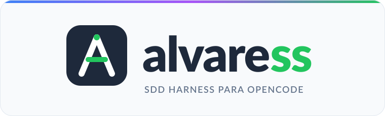
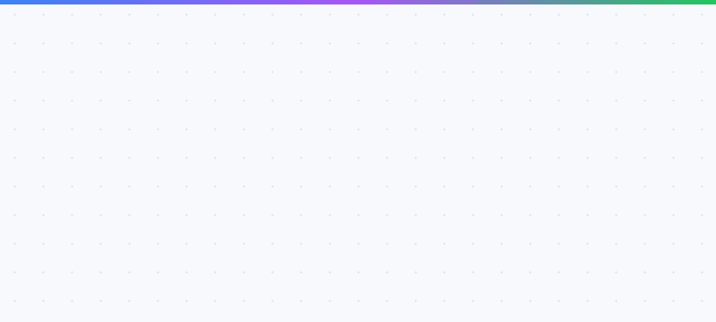

# alvaress

<p align="center">
  
</p>

**Tu arnés híbrido SDD + ODD para [OpenCode](https://opencode.ai):** decide en
local con [Laya](https://github.com/convaiinnovations/laya) (ONNX vendorizado),
ejecuta con [Aider](https://aider.chat) cuando lo habilitas o con subagentes
especializados cuando no, y valida cada cambio con
[Vite-Plus](https://vite.plus) antes de dar una tarea por terminada.

`alvaress` no reemplaza a tu agente: le da un entorno de trabajo ordenado.
Instala un agente de OpenCode llamado **`alvaress`**, sus skills y la
configuración necesaria para trabajar con [OpenSpec](https://github.com/Fission-AI/OpenSpec),
[Obsidian](https://obsidian.md) y [Graphify](https://github.com/Graphify-Labs/graphify).

> **En corto:** instalas alvaress → ejecutas `alvaress install` → `alvaress init`
> → abres OpenCode → eliges el agente `alvaress` → le pides la siguiente tarea.
> Él lee la nota ODD o la spec SDD, decide, ejecuta, valida y registra el resultado.

## Contenido

- [¿Qué es alvaress?](#qué-es-alvaress)
- [El nombre](#el-nombre)
- [El flujo en una imagen](#el-flujo-en-una-imagen)
- [Cómo funciona, en 5 pasos](#cómo-funciona-en-5-pasos)
- [Requisitos](#requisitos)
- [Instalación](#instalación)
- [Inicio rápido](#inicio-rápido)
- [El agente `alvaress`](#el-agente-alvaress)
- [Aprendizaje continuo](#aprendizaje-continuo)
- [Comandos](#comandos)
- [Modelo de decisión (Laya)](#modelo-de-decisión-laya)
- [Artefacto int8](#artefacto-int8)
- [Configuración](#configuración)
- [Manifiesto `openspec.yaml`](#manifiesto-openspecyaml)
- [Cómo funciona `run`](#cómo-funciona-run)
- [Cómo funciona `apply`](#cómo-funciona-apply)
- [Skills](#skills)
- [Obsidian](#obsidian)
- [Confiabilidad y seguridad](#confiabilidad-y-seguridad)
- [Diagramas](#diagramas)
- [Commits](#commits)
- [Desarrollo](#desarrollo)
- [Estructura del paquete](#estructura-del-paquete)
- [Licencia](#licencia)

## ¿Qué es alvaress?

Un arnés **híbrido**: usa **ODD** (Obsidian-Driven Development) para tareas
pequeñas y **SDD** (Spec-Driven Development) cuando el cambio es grande o
multi-contexto. Su trabajo es que el agente no improvise: que lea la nota o la
especificación, decida con criterios explícitos, ejecute cambios acotados y
compruebe que todo sigue funcionando.

La idea es la de Gentle AI: no sustituir a tu agente, sino darle reglas,
herramientas y un registro de lo que va pasando.

Te puede servir si:

- quieres que el agente siga una nota o una spec y no una corazonada;
- prefieres decisiones locales y privadas, sin mandar tu contexto a un servicio
  remoto;
- quieres validación real (`vp check`, `vp test`) antes de cerrar una tarea;
- quieres un historial de ejecución y una nota de proyecto en Obsidian.

## El nombre

<p align="center">
  
</p>

## El flujo en una imagen


De izquierda a derecha: el agente avanza por cinco fases y, en cada una, usa
una herramienta distinta. Obsidian solo refleja el estado; el orquestador es
el único que escribe en la bóveda.

## Cómo funciona, en 5 pasos

1. **Entender.** Lee la nota ODD o `openspec.yaml`, la tarea asignada, el grafo
   de Graphify y la nota del proyecto en Obsidian. No empieza a programar a
   ciegas.
2. **Decidir.** `Laya` elige entre ODD y SDD, estima la complejidad y marca
   los riesgos. Si el modelo no está disponible, usa heurísticas locales.
3. **Ejecutar.** Usa Aider si está habilitado; si no, reparte el trabajo entre
   los subagentes `alvaress-explorer`, `alvaress-implementer`,
   `alvaress-verifier` y `alvaress-fixer`. El alcance está acotado por la nota o
   la tarea.
4. **Validar.** Ejecuta `vp check` y `vp test`. Si fallan, entra en `Fixing`
   con un máximo de dos reintentos; si el fallo es nuclear, para en `Halted`.
5. **Cerrar.** Actualiza el estado, escribe `.laya/last_run.log`, muestra el
   reporte `READY` y registra el cierre en Obsidian.

## Requisitos

Solo necesitas instalar Node.js 20 o superior y pnpm; el resto lo resuelve
`alvaress install`.

| Tú instalas | El instalador resuelve |
| --- | --- |
| **Node.js 20 o superior** | Laya + `onnxruntime-node` |
| **pnpm** (gestor por defecto) | Vite-Plus (`vite-plus`) |
| Git (recomendado) | Graphify (`graphifyy`) |
| | Obsidian, si se puede instalar |
| | pipx, si falta |
| | Aider (`aider-chat`), solo si lo habilitas |
| | `oxlint`, TypeScript y `@types/node` como fallback |

**Sobre pipx:** si falta, el instalador lo instala con el gestor de tu sistema
(`brew`, `apt-get`, `dnf`, `pacman`, `zypper`, `apk`) o con
`python3 -m pip install --user pipx`. Solo si no encuentra ninguna vía te pide
instalarlo a mano.

**Sobre Laya:** alvaress trae el motor vendorizado (`src/decision/vendor/laya`)
y el instalador baja el runtime de ONNX y el bundle de pesos (~1.7 GB). El bundle
se verifica con SHA-256 y queda en una caché global compartida
(`~/.cache/alvaress/laya-onnx/<revision>`), así que varios proyectos usan el
mismo modelo. Después todo corre en local. Si aún no está instalado, alvaress
arranca con heurísticas y te avisa en `doctor`.

## Instalación

```bash
pnpm add -g alvaress
```

También puedes probarlo sin instalación global:

```bash
pnpm dlx alvaress --help
```

### Instalación desatendida

Para CI o para dejar el equipo listo sin preguntas:

```bash
alvaress install --yes
```

`--yes` selecciona los componentes requeridos, usa la configuración existente o
los valores por defecto y no pregunta nada. Instala lo que falte (runtime de
Laya y su modelo, Vite-Plus, Graphify y las dependencias de validación), crea
`openspec.yaml` si
el proyecto es un repositorio y no crea `.alvaressrc.json`. Aider solo se
instala si ya está habilitado en la configuración. Si falta la API key del
implementador y Aider está habilitado, avisa al terminar.

## Inicio rápido

```bash
# 1. Instalador: agente, skills, componentes y configuración.
#    Confirma la descarga del modelo de Laya cuando te pregunte.
alvaress install

# 2. Prepara el proyecto: manifiesto, tareas, skills y agente local.
alvaress init

# 3. Abre OpenCode y selecciona el agente alvaress.
opencode
#    Pulsa Tab hasta ver "alvaress" o ejecuta:
opencode run --agent alvaress "Implementa la tarea TASK-01 siguiendo la spec"
```

Dentro de OpenCode, basta con pedirle:

```text
Implementa la próxima tarea pendiente de openspec.yaml.
```

Él leerá la spec, consultará el modelo de decisión si hace falta, ejecutará
Aider o editará directamente, validará y actualizará el estado de la tarea.

## El agente `alvaress`

El instalador escribe el agente en dos sitios:

- **Global:** `~/.config/opencode/agents/alvaress.md`
- **Proyecto:** `.opencode/agents/alvaress.md`

Es un agente `primary`, seleccionable con **Tab** en OpenCode o con
`opencode run --agent alvaress`. No cambia tu agente por defecto.

Además instala cuatro subagentes `subagent` en la misma carpeta:

| Subagente | Para qué sirve | Límite |
| --- | --- | --- |
| `alvaress-explorer` | Solo lectura: localiza código y contexto y propone un alcance cerrado. | No edita ni escribe en la bóveda. |
| `alvaress-implementer` | Implementa una micro-tarea ODD o una tarea SDD dentro del alcance. | Sin git, sin cierre, sin dependencias nuevas. |
| `alvaress-verifier` | Ejecuta Vite-Plus y devuelve el error exacto. | No edita archivos. |
| `alvaress-fixer` | Repara un fallo trivial, máximo dos intentos. | No toca tests ni git; HALT si es nuclear. |

Cada subagente declara sus skills obligatorias, un límite de pasos y permisos
propios. Los cuatro tienen la bóveda Obsidian como solo lectura, no pueden lanzar
otros subagentes ni consultar la web, y no pueden hacer `git push`,
`git reset`, `git commit` ni `rm -rf`. El orquestador es el único que ejecuta
`alvaress apply`, `alvaress verify`, `alvaress obsidian note`, `alvaress archive`
y `alvaress learn add`.

Su prompt incluye:

- el flujo híbrido SDD/ODD: entender → decidir → ejecutar → validar → cerrar;
- el uso de Laya en los puntos clave (máximo 3 llamadas por solicitud);
- la política de ejecución: Aider si está activo o subagentes especializados si
  no lo está; edición directa para cambios triviales;
- la prohibición de enviar secretos o código completo a Laya;
- reglas de eficiencia de tokens: Graphify antes de `grep`/`read`, lecturas
  localizadas y resúmenes en lugar de logs completos;
- aprendizaje continuo: consulta el playbook global al empezar y solo guarda lo
  que realmente marque diferencia al cerrar;
- una personalidad amigable, con modismos mexicanos ligeros y ocasionales, y
  respuestas cortas por defecto: estado, cambios principales y validación. El
  detalle solo se explica si lo pides.

Puedes ver o reinstalar el agente sin ejecutar el instalador interactivo:

```bash
alvaress agent show
alvaress agent install
alvaress agent install --no-global
alvaress agent install --no-project
```

## Aprendizaje continuo

El agente aprende entre proyectos sin mandar nada a la nube. Los aprendizajes se
guardan en `~/.alvaress/memory/`:

- `learnings.json`: la fuente de verdad, con tipo, título, detalle, tags,
  proyecto, origen y contador de usos.
- `PLAYBOOK.md`: un resumen legible que el agente consulta al empezar.

Antes de trabajar, el agente busca con `alvaress learn search "<tema>"` y marca
como reutilizado lo que aplicó. Al cerrar, guarda como máximo tres aprendizajes,
y solo si cumplen al menos un criterio de valor:

- evitaron un error que ya se repitió;
- ahorran varios pasos o más de diez minutos;
- cambiaron una decisión de arquitectura, validación o alcance;
- son una convención estable del usuario o del equipo;
- corrigen una instrucción del agente, una skill o el CLI.

**Cero aprendizajes es un cierre válido.** No hay cuota ni obligación de guardar
algo en cada ciclo. El CLI también filtra el ruido: exige un título concreto y un
detalle de al menos 20 caracteres, rechaza entradas que parecen contener secretos
y actualiza la entrada existente en vez de duplicarla.

| Tipo | Para qué sirve |
| --- | --- |
| `step` | Una secuencia de pasos que ahorra tiempo. |
| `solution` | Una solución concreta a un problema recurrente. |
| `pitfall` | Un error que conviene evitar y cómo detectarlo. |
| `preference` | Una convención del usuario o del equipo. |
| `improvement` | Una mejora propuesta al prompt, a una skill o al CLI. |

```bash
alvaress learn search "migraciones"
alvaress learn add solution "Validar migraciones en seco" \
  --body "Ejecutar el SQL en una transacción y revertir antes de aplicar." \
  --tag db --tag migrations --source TASK-01
alvaress learn list --kind pitfall
alvaress learn use L-1a2b3c4d
alvaress learn playbook
alvaress learn prune --keep 100 --dry-run
```

Los `improvement` son propuestas: el agente los menciona al usuario y no edita su
propio prompt ni sus skills sin aprobación. El store es local; puedes cambiarlo
con `ALVARESS_MEMORY_DIR`.

## Comandos

| Comando | Descripción |
| --- | --- |
| `alvaress run "<petición>" [--task TASK_ID] [--files a.ts,b.ts] [--mode odd\|sdd] [--dry-run] [--no-commit] [--no-learn]` | Ejecuta el arnés híbrido de principio a fin: explora, decide con Laya, trabaja con Aider o subagentes, valida con Vite-Plus, cierra Obsidian y hace commit de los archivos del run. `--dry-run` solo muestra el plan. |
| `alvaress -i` / `--inspect-last-run` | Muestra el log completo del último run (`.laya/last_run.log`). |
| `alvaress install [--yes]` | Instala agente, Laya, Obsidian, Graphify, Vite-Plus y dependencias de validación. Aider es opcional. Detecta o instala lo que falte, crea la bóveda y genera la configuración global y, si procede, la local y `openspec.yaml`. `--yes` no pregunta nada. |
| `alvaress init [--no-link]` | Crea `.harness/tasks`, `.harness/skills`, `openspec.yaml` (si falta), las skills y el agente del proyecto. Si `obsidianVaultPath` está configurado, conecta la bóveda. Con `--no-link` no crea enlaces ni agente global. |
| `alvaress apply [TASK...] [--dry-run] [--force] [--update-graph]` | Ejecuta las tareas pendientes (o los ids indicados) con Aider. `--dry-run` muestra los grupos sin invocar a Aider ni modificar el manifiesto. `--force` ignora un lock huérfano y `--update-graph` actualiza Graphify al terminar. |
| `alvaress verify <TASK_ID>` | Ejecuta la validación de la tarea o del proyecto y, si falla, pide una reparación automática. |
| `alvaress archive <SPEC_ID>` | Archiva una spec con todas sus tareas en `Done`; antes crea un backup del manifiesto. |
| `alvaress doctor [--json]` | Diagnóstico previo: Node, configuración, gestor de paquetes, git, Laya, Vite-Plus, Aider, Graphify, Obsidian, manifiesto, comandos de validación, frescura del grafo y locks. |
| `alvaress report [latest\|list\|show <id>]` | Muestra los reportes de ejecución guardados en `.harness/runs/`. |
| `alvaress restore [--list\|latest\|<id>]` | Lista o restaura `openspec.yaml` desde `.harness/backups/`. |
| `alvaress skills [--no-link]` | Reinstala las skills del proyecto y sus enlaces globales. |
| `alvaress learn [add\|list\|search\|show\|use\|prune\|playbook]` | Guarda, busca y reutiliza aprendizajes globales en `~/.alvaress/memory/`. `add` aplica un filtro de calidad y no duplica entradas. |
| `alvaress agent [install\|show]` | Instala el agente `alvaress` y sus subagentes en OpenCode, o imprime el prompt del orquestador. |
| `alvaress obsidian [status\|sync\|note]` | Consulta la bóveda y la nota del proyecto (`status`), las crea o repara (`sync`), o registra el cierre de una tarea (`note`, también con `--from-run latest`). |
| `alvaress config [show\|paths]` | Muestra la configuración resuelta (con secretos enmascarados) o las rutas de configuración. |

Códigos de salida: `0` éxito, `1` error o tarea fallida, `130` operación cancelada.

## Modelo de decisión (Laya)

`Laya` es el modelo de decisión de ConvAI Innovations, ejecutado en local con
ONNX Runtime. No hay API key ni servicio remoto: el modelo corre en tu máquina y
solo recibe un resumen del estado, nunca el código completo ni secretos.

alvaress incluye un port TypeScript del motor de
[`@receptron/laya`](https://github.com/receptron/laya) en
`src/decision/vendor/laya`. El port mantiene el layout de secuencia y las
temperaturas del checkpoint oficial, y añade verificación SHA-256 por archivo al
descargar los pesos. Ver [`THIRD_PARTY_NOTICES.md`](THIRD_PARTY_NOTICES.md).

`alvaress` lo usa en tres puntos:

- **Ruta:** decide entre ODD y SDD y estima la complejidad.
- **Riesgo:** clasifica el riesgo residual del diff.
- **Triaje:** decide si un fallo de validación es trivial, nuclear o necesita al
  orquestador.

Si el modelo no está disponible, alvaress usa heurísticas deterministas y lo
indica en `doctor`. El adaptador está en `src/decision/laya.ts`; las heurísticas,
en `src/decision/heuristics.ts`.

```bash
alvaress doctor            # comprueba Laya y Vite-Plus
alvaress install           # instala lo que falte
```

Configuración:

```json
{
  "laya": {
    "enabled": true,
    "device": "cpu",
    "threads": 4,
    "timeoutMs": 30000,
    "fallbackToHeuristic": true
  },
  "vitePlus": {
    "checkCommand": "vp check",
    "testCommand": "vp test",
    "fallbackToPackageManager": true
  }
}
```

`modelDir` es opcional: si lo defines, apunta a un directorio con
`laya.onnx`, `laya.onnx.data`, `laya_config.json` y `tokenizer/`. Si lo dejas
vacío, alvaress usa la caché global y espera el bundle fijado por revisión que
instala `alvaress install`. Si falta, el run sigue con heurísticas.
`threads` controla los hilos intra-op de ONNX Runtime en CPU.

### Artefacto int8

El bundle fp32 pesa 1.69 GB. `scripts/quantize-laya.py` genera un bundle int8 de
488 MB (3.5× menos) con `MatMulNBits` de 8 bits en bloques de 32 y
`GatherBlockQuantized` para la tabla de embeddings. Conserva las decisiones del
modelo fp32 y carga en ~0.3 s en vez de ~2.6 s; la inferencia suelta es ~20 %
más lenta, pero la carga inicial compensa en un run de hasta tres llamadas.

```bash
~/.cache/alvaress/quant-venv/bin/python scripts/quantize-laya.py \
  --source ~/.cache/alvaress/laya-onnx/<revision> \
  --output ~/.cache/alvaress/laya-onnx-int8/<revision>
```

El directorio incluye `laya_int8.json` con tamaños y SHA-256. `verifyBundle` lo
detecta y valida contra él, así que basta con apuntar `laya.modelDir` ahí. El
artefacto aún no se publica como release asset. Detalles, mediciones y
limitaciones en [`docs/laya-int8.md`](docs/laya-int8.md).

### Privacidad

El `state` que recibe Laya se redacta antes de enviarse al modelo: claves,
tokens y contraseñas se sustituyen por `[REDACTED_*]`. No incluyas datos
personales ni código propietario completo. Usa un resumen de 1-3 frases; el
prompt del agente `alvaress` ya lo exige.

## Configuración

La configuración se resuelve con precedencia **local sobre global**:

- **Global:** `~/.alvaressconfig.json`
- **Local del proyecto:** `.alvaressrc.json`

Los campos escalares del archivo local sustituyen a los globales; los objetos
`env` se fusionan (el local gana en claves repetidas). Si un campo no existe en
ninguno de los dos, se aplica el valor por defecto.

```json
{
  "obsidianVaultPath": "/ruta/a/tu/boveda/obsidian",
  "packageManager": "pnpm",
  "scope": "warn",
  "graphify": { "autoUpdate": false },
  "laya": {
    "enabled": true,
    "device": "cpu",
    "threads": 4,
    "timeoutMs": 30000,
    "fallbackToHeuristic": true
  },
  "vitePlus": {
    "checkCommand": "vp check",
    "testCommand": "vp test",
    "fallbackToPackageManager": true
  },
  "aider": { "enabled": false, "timeoutMs": 600000, "extraArgs": [], "inheritEnv": true },
  "models": {
    "aiderImplementer": {
      "modelName": "deepseek/deepseek-chat",
      "apiKey": "sk-deepseek",
      "apiBase": "",
      "env": { "DEEPSEEK_API_KEY": "sk-deepseek" }
    }
  },
  "validation": {
    "maxAttempts": 3,
    "commands": [
      "pnpm exec vp check",
      "pnpm exec vp test"
    ]
  }
}
```

Valores por defecto:

| Campo | Valor |
| --- | --- |
| `laya.enabled` | `true` |
| `laya.modelDir` | vacío (caché global) |
| `laya.device` | `cpu` |
| `laya.threads` | sin límite explícito |
| `laya.timeoutMs` | `30000` (30 s) |
| `laya.fallbackToHeuristic` | `true` |
| `vitePlus.checkCommand` | `vp check` |
| `vitePlus.testCommand` | `vp test` |
| `models.aiderImplementer.modelName` | `deepseek/deepseek-chat` |
| `packageManager` | `pnpm` |
| `scope` | `warn` |
| `aider.enabled` | `false` |
| `aider.timeoutMs` | `600000` (10 min) |
| `validation.maxAttempts` | `3` |
| `validation.commands` | `pnpm exec vp check`, `pnpm exec vp test` |

El implementador recibe `DEEPSEEK_API_KEY` y `OPENAI_API_KEY` con `apiKey`, y
`OPENAI_API_BASE` con `apiBase`. Las variables de `env` se añaden al subproceso
de Aider.

`alvaress config show` enmascara `apiKey` y las variables de entorno cuyo nombre
contiene `KEY`, `TOKEN`, `SECRET` o `PASS`.

## Manifiesto `openspec.yaml`

```yaml
specification: "1.0.0"
project: "mi-app-nestjs"
bounded_contexts:
  - name: "catalog"
    path: "src/catalog"
  - name: "billing"
    path: "src/billing"
specs:
  - id: "SPEC-001"
    title: "Crear endpoint de facturación"
    status: "Proposed"
    context: "billing"
    tasks:
      - id: "TASK-01"
        description: "Crear el repositorio de base de datos para facturas"
        status: "Pending"
        priority: 10
        estimate: "30m"
        depends_on: ["TASK-00"]
        validation:
          - "pnpm exec tsc --noEmit"
        rollback: "Revertir el repositorio y la migración"
        files:
          - "src/billing/repositories/invoice.repository.ts"
```

- `depends_on` ordena la ejecución real dentro del grupo.
- `validation` sustituye a los comandos globales para esa tarea.
- `priority` ordena tareas independientes.
- `estimate` y `rollback` documentan coste y vuelta atrás.

Estados admitidos:

- **Spec:** `Proposed`, `Verified`, `Archived`, `Failed`.
- **Tarea:** `Pending`, `InProgress`, `Done`, `Failed`.

Los ids de specs y tareas solo admiten letras, números, punto, guion y guion
bajo. Los ids de tarea deben ser únicos en todo el manifiesto.

## Cómo funciona `run`

`alvaress run` es la vía principal del arnés. Una sola orden recorre la máquina de
estados:

```bash
alvaress run "agrega un helper de fechas" --files src/fechas.ts
```

1. **Exploring.** Detecta ODD o SDD, lee la nota de Obsidian o `openspec.yaml` y
   cierra el alcance (archivos, criterios y comandos de validación).
2. **Working.** Delega en Aider si `aider.enabled` es `true`; si no, en
   `alvaress-implementer`. El worker no hace commits ni escribe en la bóveda.
3. **Checking.** Ejecuta `vp check` y `vp test` (o los comandos de la tarea) y
   captura stdout/stderr en `.laya/last_run.log`.
4. **Fixing.** Si la validación falla, intenta reparar hasta dos veces. Un fallo
   nuclear, de alcance o de herramienta termina en `Halted`.
5. **Ready.** Marca la tarea SDD como `Done`, actualiza el checklist ODD, registra
   el cierre en Obsidian y hace un commit `chore(alvaress): ...` solo con los
   archivos del run. Nunca hace push.

El resultado se muestra en una sola pantalla:

```text
[alvaress] READY
Cambios Realizados:
  • src/fechas.ts -> Aider modificó el archivo
Validación:
  • vp check -> OK
  • vp test -> OK
Riesgos Detectados:
  • Sin riesgos detectados.
```

Cada ejecución deja un reporte JSON en `.harness/runs/<runId>-run.json` con el
estado, el modo, los cambios, los riesgos, la validación, el commit y el HALT (si
lo hubo). `alvaress report list` los muestra junto a los de `apply`, y
`alvaress report show <id>` abre uno concreto.

Si el run se detiene, deja `.laya/HALT.json` con el código, el motivo y el log, y
`alvaress -i` abre el detalle completo. `--dry-run` hace la exploración y muestra
el plan sin invocar al worker, sin commit y sin escribir en Obsidian.

## Cómo funciona `apply`

1. Adquiere el lock `.harness/lock` y crea un backup de `openspec.yaml`.
2. Lee las tareas `Pending` (o los ids indicados) y las agrupa.
3. Las tareas del mismo `context` o que comparten archivos (incluidos archivos
   dentro de un mismo directorio) se ejecutan **secuencialmente**, respetando
   `depends_on` y `priority`.
4. Los grupos aislados se ejecutan **en paralelo** con `Promise.all`.
5. Para cada tarea genera `.harness/tasks/<TASK_ID>.md`, la marca como
   `InProgress` y llama a Aider con el mensaje de la tarea y los archivos
   asignados.
6. Al terminar Aider, comprueba el alcance del diff y ejecuta la validación
   local. Si falla, lanza un bucle de reparación con Aider hasta
   `validation.maxAttempts`.
7. Actualiza la tarea a `Done` o `Failed`, recalcula el estado del spec y
   escribe el reporte en `.harness/runs/`.

El agente `alvaress` usa `apply --dry-run` antes de lanzar un lote y elige solo
las tareas necesarias. Para cambios triviales evita Aider y edita directamente.

## Skills

El instalador escribe cinco skills en `.harness/skills/<nombre>/SKILL.md` y crea
enlaces simbólicos en:

- `~/.config/opencode/skills/<nombre>`
- `~/.claude/skills/<nombre>`

Skills incluidas:

| Skill | Qué hace |
| --- | --- |
| `read-spec-first` | Obliga a leer la nota ODD o la especificación SDD antes de programar. |
| `consult-graphify-ast` | Evita lecturas masivas de código y prioriza Graphify. |
| `self-healing-verify` | Exige validar con Vite-Plus (`vp check` y `vp test`) tras cada edición. |
| `universal-design-patterns` | Fuerza patrones de diseño y prohíbe comentarios en el código generado. |
| `obsidian-sdd` | Define en qué fases del flujo híbrido usa Obsidian el orquestador y qué pueden hacer los subagentes (solo lectura). |
| `continuous-learning` | Consulta y guarda aprendizajes globales solo cuando marcan diferencia. |
| `bounded-scope` | Mantiene al subagente en los archivos asignados y le enseña a detenerse. |
| `vite-plus-verify` | Ejecuta `vp check`/`vp test` y devuelve el error exacto sin ruido. |
| `failure-triage` | Clasifica un fallo como trivial o nuclear antes de repararlo. |

Cada subagente carga solo las skills de su perfil: el explorador usa
`consult-graphify-ast`, `obsidian-sdd` y `bounded-scope`; el implementador usa
`read-spec-first`, `universal-design-patterns`, `bounded-scope` y
`self-healing-verify`; el verificador usa `vite-plus-verify` y `bounded-scope`;
el reparador usa `failure-triage`, `self-healing-verify` y `bounded-scope`.

Claude Code consume las mismas skills y los mismos artefactos SDD; el agente
`alvaress` es nativo de OpenCode.

## Obsidian

Al seleccionar el componente Obsidian, `alvaress install`:

1. Comprueba si Obsidian está instalado (binario, escritorio, Flatpak, Snap,
   AppImage, `.app` de macOS o instalación de Windows).
2. Si no lo está, intenta instalarlo con dependencias:
   - **Linux:** Flatpak de usuario si está disponible; si no, descarga el
     `tar.gz` oficial, lo extrae en `~/.local/opt/obsidian` y crea un lanzador
     en `~/.local/bin/obsidian`.
   - **macOS:** Homebrew (`brew install --cask obsidian`) o el DMG oficial.
   - **Windows:** `winget`.
3. Usa la bóveda global configurada o `~/Obsidian`, la crea si no existe y la
   conecta al proyecto.

Si la instalación automática falla, el instalador avisa y continúa: la bóveda
se crea igualmente y puedes instalar Obsidian después desde
[obsidian.md/download](https://obsidian.md/download).

`alvaress init` también conecta la bóveda cuando `obsidianVaultPath` ya está
configurado. Dentro de la bóveda se crea:

```text
Harness/
├── Tasks -> <proyecto>/.harness/tasks
├── openspec.yaml -> <proyecto>/openspec.yaml
└── <proyecto>.md
```

La nota incluye enlaces a las tareas y al manifiesto. En SDD, Obsidian es un
espejo del estado: el agente escribe siempre en `.harness/tasks/` y
`openspec.yaml`, y la bóveda refleja los cambios mediante enlaces simbólicos. En
ODD, la nota de la tarea es la fuente y se actualiza al cerrar. No hay que
sincronizar nada a mano ni duplicar contenido.

### Uso en el flujo híbrido

La skill `obsidian-sdd` define el uso por fase:

| Fase | Orquestador | Subagentes |
| --- | --- | --- |
| 1 · Entender | Ejecuta `alvaress obsidian status` y lee la nota de la tarea (ODD) o del proyecto (SDD) para recuperar contexto, decisiones y riesgos. | Los de exploración pueden leer la nota y los enlaces. |
| 2 · Decidir | Usa la nota para resumir el estado que envía a Laya. Sin secretos. | No consultan Laya ni escriben en la bóveda. |
| 3 · Ejecutar | En SDD escribe en `.harness/tasks/` y `openspec.yaml`; en ODD implementa el alcance de la nota. | Escriben solo en el proyecto; la bóveda es de solo lectura. |
| 4 · Validar | Ejecuta Vite-Plus (`vp check` y `vp test`). | El verificador ejecuta los comandos y no toca la bóveda. |
| 5 · Cerrar | Registra el cierre con `alvaress obsidian note` y marca `[x]` en ODD. | Devuelven el resultado al orquestador. |

Reglas clave:

- Solo el orquestador actualiza la nota, y siempre con `alvaress obsidian note`;
  nunca editando `<bóveda>/Harness/` a mano.
- Los subagentes reciben la instrucción explícita de no escribir en la bóveda.
- Si no hay bóveda configurada, el flujo continúa sin ella.
- En SDD no se crea una nota por tarea: se usa la nota del proyecto y los enlaces
  `[[Tasks/...]]`. En ODD se actualiza la nota de la tarea sin duplicar el proyecto.

### Comandos de Obsidian

```bash
alvaress obsidian status
alvaress obsidian sync
alvaress obsidian note \
  --task TASK-01 \
  --summary "Qué cambió" \
  --validation "pnpm test: 141/141" \
  --risk "Riesgos pendientes" \
  --next "Siguiente paso"

alvaress obsidian note --from-run latest --task TASK-01
```

- `status` muestra en JSON la bóveda configurada, si existe, la ruta de la nota
  y los enlaces.
- `sync` crea o repara la estructura `Harness/`, la nota y los enlaces.
- `note` exige `--summary` y añade una entrada a la sección `## Registro` de la
  nota del proyecto.

## Confiabilidad y seguridad

- **Lock global** en `.harness/lock`: impide dos `apply` simultáneos. Si el PID
  dueño ya no existe o el lock supera 4 h, se considera huérfano; `--force` lo
  reemplaza de forma explícita.
- **Escritura atómica** de `openspec.yaml`, reportes, caché y nota de Obsidian
  mediante archivo temporal + `rename`.
- **Backups** del manifiesto en `.harness/backups/` antes de cada `apply` y
  `archive`. `alvaress restore latest` recupera el último.
- **Reportes de ejecución** en `.harness/runs/<id>-apply.json` con estado,
  duración, archivos, alcance y validación de cada tarea. Los logs de Aider se
  guardan junto al reporte.
- **Control de alcance** con `git status`: `scope: "strict"` falla la tarea si
  Aider toca archivos fuera de los asignados; `"warn"` (por defecto) solo avisa;
  `"off"` lo desactiva.
- **Timeout de Aider** configurable (`aider.timeoutMs`, 10 min por defecto) con
  terminación `SIGTERM` y luego `SIGKILL`.
- **Entorno saneado** para Aider: no hereda credenciales de npm ni GitHub.
- **Timeout de Laya** configurable (`laya.timeoutMs`) con fallback heurístico.
- **Frescura de Graphify** comprobada por `doctor`; `apply --update-graph` o
  `graphify.autoUpdate: true` lo actualizan al terminar.
- **Permisos estrictos** en el agente y los subagentes: shell con allowlist,
  `git push`/`reset --hard`/`rm -rf` denegados y bóveda de solo lectura para
  subagentes.
- **Redacción de secretos** antes de enviar al modelo de decisión y al escribir
  la nota de Obsidian.
- **CI** con pnpm en Node 20/22/24 y release con `pnpm publish --provenance`.

## Diagramas

El diagrama de este README se dibujó con la skill
[`svg-diagram`](https://github.com/bybit-exchange/svg-diagram), incluida solo
para este proyecto en `.agents/skills/svg-diagram`. El SVG vive en
`assets/alvaress-flow.svg`.

El logo está en `assets/alvaress-logo.svg` y la animación del nombre en
`assets/alvaress-intro.gif`.

Si cambias el flujo, actualiza el SVG y valida que siga el estilo de la casa:

```bash
node .agents/skills/svg-diagram/tools/svg-lint/bin/svg-lint.mjs assets/alvaress-flow.svg
```

El linter no debe reportar errores ni advertencias.

## Commits

El repositorio usa **Conventional Commits** y los valida con husky + commitlint:

- `pre-commit`: lint-staged ejecuta `oxlint` solo sobre los archivos TS/JS staged.
- `commit-msg`: commitlint rechaza mensajes que no sigan el formato.
- CI valida los commits de cada pull request.

Formato:

```text
<tipo>(<scope opcional>): <descripción corta>
```

Tipos habituales: `feat`, `fix`, `docs`, `test`, `refactor`, `chore`, `build`,
`ci`, `perf` y `style`.

```bash
git commit -m "feat(decision): añadir caché de decisiones"
git commit -m "fix(apply): liberar el lock al fallar"
```

Validar un rango manualmente:

```bash
pnpm run commitlint --from HEAD~3 --to HEAD
```

## Desarrollo

```bash
pnpm install
pnpm run validate   # lint + typecheck de src y test
pnpm test           # build + pruebas con node:test y tsx
pnpm run build      # compila a dist/
```

Pruebas incluidas:

- configuración, manifiesto, agrupación y colisiones;
- argumentos, utilidades de FS, enlaces simbólicos y skills;
- verificación y bucle self-healing con Aider simulado;
- `apply` con grupos paralelos/secuenciales, fallos y dry-run;
- motor de decisión `Laya` con agente simulado y fallback heurístico;
- adaptador de `Laya`, timeout, triaje de fallos y riesgos;
- módulo vendorizado: secuencia, temperaturas, softmax y verificación del bundle;
- caché de decisión, redacción de secretos, lock, backups, reportes y
  alcance del diff;
- `doctor`, `report`, `restore`, `archive` y subagentes;
- detección e instalación de Obsidian, bóveda, nota y comandos `obsidian`;
- instalación del agente global, de proyecto y de subagentes;
- instalación automática de pipx y de las dependencias de Python;
- CLI de extremo a extremo con `dist/`.

## Estructura del paquete

```text
src/
├── cli.ts
├── agent/           prompt, subagentes e instalación
├── commands/        install, init, agent, obsidian, skills, config, doctor, report, restore, archive
├── core/            contratos, máquina de estados y HALT
├── config/          loader con precedencia global/local
├── decision/        adaptador de Laya, motor vendorizado y heurísticas
├── ui/              paleta TrueColor, loader de estados y reporte final
├── graphify/        estado y actualización del grafo
├── openspec/        manifiesto y tipos
├── orchestrator/    agrupación, Aider, verificación, apply, backups, reportes y alcance
├── skills/          definición e instalación de skills
├── obsidian/        conexión con la bóveda
└── utils/           args, errores, FS, lock, gestor de paquetes, pipx, redacción, logger y procesos
test/                pruebas con node:test
assets/              logo, animación y diagramas SVG del README
.agents/skills/      skills locales del proyecto (svg-diagram)
docs/spec.md         prompt original de generación del proyecto
```

## Licencia

MIT. Consulta [LICENSE](LICENSE).
