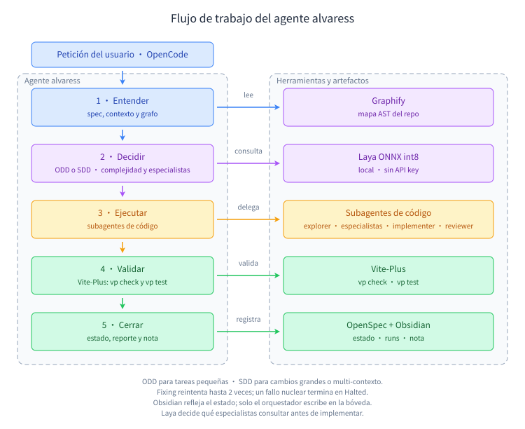

# alvaress

**Arnés híbrido SDD + ODD para [OpenCode](https://opencode.ai).** Decide en local
con [Laya](https://github.com/convaiinnovations/laya) (ONNX, sin API key),
ejecuta con subagentes de código inspirados en el ciclo de
[Aider](https://aider.chat) y valida cada cambio con
[Vite-Plus](https://vite.plus) antes de cerrar una tarea.

`alvaress` no reemplaza a tu agente: le da un entorno de trabajo ordenado.
Instala un agente de OpenCode llamado **`alvaress`**, sus skills y la
configuración necesaria para trabajar con [OpenSpec](https://github.com/Fission-AI/OpenSpec),
[Obsidian](https://obsidian.md) y [Graphify](https://github.com/Graphify-Labs/graphify).
El ejecutor es un conjunto de subagentes especializados: Laya decide qué
especialistas consultar, el implementer aplica el cambio y el reviewer revisa el
diff antes de cerrar.

## Contenido

- [Qué es alvaress](#qué-es-alvaress)
- [SDD y ODD](#sdd-y-odd)
- [Flujo del agente](#flujo-del-agente)
- [Requisitos](#requisitos)
- [Instalación](#instalación)
- [Inicio rápido](#inicio-rápido)
- [Comandos](#comandos)
- [Configuración](#configuración)
- [Herramientas que instala y por qué](#herramientas-que-instala-y-por-qué)
- [Agente, subagentes y skills](#agente-subagentes-y-skills)
- [Obsidian](#obsidian)
- [Aprendizaje continuo](#aprendizaje-continuo)
- [Manifiesto `openspec.yaml`](#manifiesto-openspecyaml)
- [Confiabilidad y seguridad](#confiabilidad-y-seguridad)
- [Desarrollo](#desarrollo)
- [Estructura del paquete](#estructura-del-paquete)
- [Licencia](#licencia)

## Qué es alvaress

Es un arnés para que el agente no improvise. Antes de tocar código lee la fuente
del trabajo (una nota ODD o una spec SDD), cierra el alcance, decide con
criterios explícitos, ejecuta cambios acotados y comprueba que todo sigue
funcionando.

Te puede servir si:

- quieres que el agente siga una nota o una spec y no una corazonada;
- prefieres decisiones locales y privadas, sin mandar tu contexto a un servicio
  remoto;
- quieres validación real (`vp check`, `vp test`) antes de cerrar una tarea;
- quieres historial de ejecución, reportes y una nota de proyecto en Obsidian.

El flujo es híbrido: **ODD** para trabajo ligero y **SDD** para cambios grandes
o multi-contexto. Laya elige la ruta; tú puedes forzarla con `--mode`.

## SDD y ODD

**SDD (Spec-Driven Development)** escribe primero una especificación con tareas,
dependencias, archivos y validación; el agente ejecuta contra ese contrato.
**ODD (Organic Driven Development)** es el flujo ligero: se autoriza el cambio,
se explora solo lo necesario y se cierra con la evidencia mínima, sin crear
artefactos pesados. En alvaress, la fuente ODD es una nota de tarea o de
proyecto; la fuente SDD es `openspec.yaml` más la tarea.

| | ODD | SDD |
| --- | --- | --- |
| **Qué es** | **Organic Driven Development**: flujo orgánico y orientado al resultado. El contexto mínimo necesario, sin ceremonia extra. | **Spec-Driven Development**: especificación formal con tareas, dependencias, archivos y validación. |
| **Cuándo** | Cambios pequeños o medianos, un solo contexto, alcance claro. | Cambios grandes, multi-contexto, contratos, migraciones o varias tareas. |
| **Fuente** | Una nota de tarea o de proyecto: objetivo, checklist de aceptación, archivos asignados y riesgos. En alvaress vive en la bóveda Markdown (compatible con Obsidian) o, con `--task`, en `.harness/tasks/<TASK>.md`. | `openspec.yaml` y `.harness/tasks/<TASK>.md`. |
| **Cierre** | Marca el checklist, actualiza la nota y hace commit de los archivos del run. | Marca la tarea `Done`, actualiza el spec y hace commit de los archivos del run. |

En ambos modos el agente escribe el código, valida y deja rastro. La diferencia
es cuánta estructura necesita el trabajo, no quién manda: la fuente siempre es
la nota o la spec, nunca la memoria del modelo.

## Flujo del agente



El agente avanza por cinco fases. En cada una usa una herramienta distinta y
cierra el alcance antes de pasar a la siguiente.

| Fase | Qué pasa | Herramienta |
| --- | --- | --- |
| **1 · Entender** | Detecta ODD o SDD, lee la nota o `openspec.yaml`, consulta el grafo, carga solo los aprendizajes relevantes y cierra archivos, criterios y comandos de validación. | Graphify, OpenSpec, Obsidian, memoria |
| **2 · Decidir** | Elige la ruta, estima complejidad y decide qué especialistas consultar. Si Laya no está disponible, usa heurísticas. | Laya ONNX int8 |
| **3 · Ejecutar** | Pide briefs a los especialistas, el implementer aplica el cambio y el reviewer revisa el diff. El worker no hace commits ni escribe en la bóveda. | Subagentes |
| **4 · Validar** | Ejecuta `vp check` y `vp test` (o los comandos de la tarea). Si falla, busca un pitfall que coincida, repara y vuelve a validar. | Vite-Plus, memoria |
| **5 · Cerrar** | Marca la tarea o el checklist, escribe el reporte, actualiza la nota, guarda hasta tres aprendizajes y hace commit solo con los archivos del run. | OpenSpec, Obsidian, Git, memoria |

### Estados de un `run`

| Estado | Qué pasa | Quién actúa |
| --- | --- | --- |
| `Exploring` | Detecta el modo, lee la fuente, consulta Graphify, carga los aprendizajes y cierra el alcance. Después decide los especialistas. | Orquestador, `alvaress-explorer` y especialistas |
| `Working` | Implementa el cambio. | `alvaress-implementer` o `alvaress-implementer-lite` |
| `Checking` | Ejecuta la validación y guarda stdout/stderr en `.laya/last_run.log`. | Orquestador o `alvaress-verifier` |
| `Fixing` | Busca un pitfall que coincida con el error, repara la causa y vuelve a validar. Máximo dos intentos. | `alvaress-fixer` |
| `Ready` | Marca el cierre, escribe el reporte y la nota, guarda aprendizajes y hace commit de los archivos del run. | Orquestador |
| `Halted` | Fallo nuclear, de alcance o de herramienta. No hay commit ni cierre. | Orquestador |

Laya decide antes de delegar: primero la ruta y la complejidad, y después del
alcance qué especialistas aportan contexto. La regla de proporcionalidad evita
pagar un arquitecto o un reviewer en un cambio ODD trivial o pequeño. Cada brief
alimenta al siguiente especialista y, al final, al implementer; la revisión del
diff se pasa al fixer cuando la validación falla.

Se detiene en `Halted` cuando el fixer devuelve `nuclear`, el mismo error
aparece dos veces, el diff se sale del alcance, falta una herramienta requerida,
el worker agota el timeout o una reparación deja el diff vacío. En `Halted` no
insiste: libera el lock, conserva `.laya/HALT.json` y el log, y espera una
decisión humana.

## Requisitos

- **Node.js 20 o superior.** Es el único requisito obligatorio.
- **pnpm.** Es el gestor recomendado y el que usa el instalador para las
  dependencias Node. **No es obligatorio:** si falta, alvaress cae a npm y te
  avisa. Node 20 trae Corepack, así que puedes activarlo sin instalar nada más:

  ```bash
  corepack enable pnpm
  # o, si prefieres instalarlo global:
  npm install -g pnpm
  ```

- **Git.** Recomendado para el control de alcance y los commits del run.
- **OpenCode.** Lo instalas tú; alvaress añade el agente y sus skills.

El resto lo resuelve `alvaress install`: Laya, ONNX Runtime, tokenizers,
Vite-Plus, Graphify (con `uv`) y las dependencias de validación. Obsidian es
opcional: el instalador crea la bóveda en Markdown, pero no instala la app.

## Instalación

La vía recomendada es pnpm:

```bash
corepack enable pnpm
pnpm add -g alvaress
```

También puedes probarlo sin instalación global:

```bash
pnpm dlx alvaress --help
# o, si prefieres npm:
npx alvaress --help
```

Si tu proyecto usa npm, no pasa nada: `alvaress install` seguirá usando pnpm
para sus dependencias Node y solo usará npm si pnpm no está en el PATH.

### Checklist de componentes

El instalador interactivo muestra una sola lista con todo lo que va a instalar:

```text
🧠 Laya          decisión local · ONNX Runtime, tokenizers y modelo int8 (488 MB) · obligatorio
⚡ Vite-Plus     vp check y vp test · obligatorio
📊 Graphify      grafo AST del repositorio · instala uv si falta · hooks de git · obligatorio
🧩 Skills        15 skills del proyecto y sus enlaces globales · obligatorio
🧭 Orquestador   agente alvaress en OpenCode · obligatorio
🤖 Subagentes    explorer, researcher, architect, designer, implementer, implementer-lite,
                 tester, verifier, reviewer, fixer · obligatorio
🗂️ Obsidian     (solo para que tú visualices; los agentes no lo usan)
```

Los obligatorios se pueden intentar desmarcar, pero el instalador los restaura y
avisa: sin ellos el arnés no funciona. Obsidian es la única casilla opcional y
la bóveda Markdown se crea igual. `typescript` y `@types/node` no aparecen en la
lista porque son implícitos: se instalan si faltan, sin ocupar casilla.

### Instalación desatendida

Para dejar el equipo listo sin preguntas:

```bash
alvaress install --yes
```

`--yes` instala el set fijo (agente, Laya, Graphify, Vite-Plus y validación),
usa la configuración existente o los valores por defecto y no pregunta nada.
Instala lo que falte, crea `openspec.yaml` si el proyecto es un repositorio y no
crea `.alvaressrc.json`. No instala la app Obsidian; añade `--with-obsidian` si
quieres que también la instale.

### Qué hace el instalador

1. Instala el set fijo (agente, Laya, Graphify, Vite-Plus y validación). La app
   Obsidian queda fuera salvo que marques esa casilla o pases
   `--with-obsidian`.
2. Pregunta lo que necesita decisión humana antes del trabajo pesado: bóveda,
   ruta del modelo de Laya y modelos de orquestador y subagentes.
3. Guarda `~/.alvaressconfig.json` para no perder tus elecciones si algo falla.
4. Instala en paralelo Graphify (con `uv tool install`), las dependencias Node y
   el bundle int8 de Laya; la app Obsidian solo si la pediste. Las dependencias
   Node van en una sola llamada a pnpm; los archivos pequeños del bundle se bajan
   en paralelo y el progreso es agregado.
5. Activa los hooks de Graphify con `graphify hook install` si el proyecto es un
   repositorio git. El grafo se reconstruye tras `commit`, `checkout`, `merge` y
   `rewrite`, y se registra el merge driver de `graphify-out/graph.json`. Si
   husky está configurado, los hooks se escriben en `.husky/` junto a los tuyos.
6. Crea o actualiza `.alvaressrc.json` si aceptas overrides locales.
7. Crea `openspec.yaml` si el proyecto es un repositorio y no lo tiene.
8. Conecta `<bóveda>/Harness/` con enlaces a `.harness/tasks` y `openspec.yaml`.
9. Escribe las skills en `.harness/skills/` y sus enlaces globales.
10. Instala el agente `alvaress` y sus diez subagentes en OpenCode con el
    modelo elegido en su frontmatter.

Al final el instalador resume proyecto, rutas, configuración y los modelos
efectivos, para que no tengas que abrir el JSON.

Comprueba cómo quedó todo con:

```bash
alvaress doctor
alvaress doctor --json
```

## Inicio rápido

```bash
# 1. Instalador: agente, skills, componentes, modelos y configuración.
alvaress install

# 2. Abre OpenCode y selecciona el agente alvaress.
opencode
#    Pulsa Tab hasta ver "alvaress" o ejecuta:
opencode run --agent alvaress "Implementa la tarea TASK-01 siguiendo la spec"
```

`alvaress init` sigue existiendo para reparar o reinstalar en un proyecto que ya
tenía el arnés: crea `.harness/`, `openspec.yaml`, skills y agente local sin
volver a descargar componentes. No hace falta en una instalación nueva.

Dentro de OpenCode, basta con pedirle:

```text
Implementa la próxima tarea pendiente de openspec.yaml.
```

Él leerá la spec, consultará el modelo de decisión si hace falta, delegará en el
subagente de código, validará y actualizará el estado de la tarea.

## Comandos

| Comando | Qué hace | Opciones principales |
| --- | --- | --- |
| `alvaress run "<petición>"` | Ejecuta el arnés de principio a fin: explora, decide, trabaja, valida y cierra. | `--task`, `--files`, `--mode odd\|sdd\|auto`, `--dry-run`, `--no-commit`, `--self-check`, `--no-learn`, `--force` |
| `alvaress -i` / `--inspect-last-run` | Muestra el log completo del último run (`.laya/last_run.log`). | — |
| `alvaress install` | Instala el set fijo (agente, Laya, Graphify, Vite-Plus y validación) y crea la bóveda Markdown. | `--yes`, `-y`, `--with-obsidian` |
| `alvaress init` | Crea `.harness/`, `openspec.yaml`, skills y agente del proyecto. | `--no-link` |
| `alvaress apply [TASK...]` | Ejecuta tareas pendientes (o las indicadas) con el worker de subagentes, en grupos aislados. | `--dry-run`, `--force`, `--update-graph`, `--no-lock` |
| `alvaress verify <TASK_ID>` | Ejecuta la validación de la tarea y, si falla, pide reparación automática al fixer. | — |
| `alvaress archive <SPEC_ID>` | Archiva una spec con todas sus tareas en `Done`. Antes crea un backup. | — |
| `alvaress doctor` | Diagnóstico de Node, configuración, modelos, frontmatter del agente, gestor, git, Laya, Vite-Plus, Graphify, Obsidian, manifiesto, grafo y locks. | `--json` |
| `alvaress report [latest\|list\|show <id>]` | Muestra los reportes de `.harness/runs/`. | — |
| `alvaress restore [--list\|latest\|<id>]` | Lista o restaura `openspec.yaml` desde `.harness/backups/`. | `--list` |
| `alvaress skills` | Reinstala las skills del proyecto y sus enlaces globales. | `--no-link` |
| `alvaress learn <subcomando>` | Guarda, busca y reutiliza aprendizajes globales y del proyecto. | `add`, `list`, `search`, `show`, `use`, `promote`, `prune`, `playbook` |
| `alvaress agent [install\|show]` | Instala el agente y sus subagentes, o imprime el prompt del orquestador. | `--no-global`, `--no-project` |
| `alvaress models [show\|set\|configure]` | Muestra o cambia los modelos de orquestador y subagentes. | `--all`, `--orchestrator`, `--subagents`, `--no-install` |
| `alvaress obsidian [status\|sync\|note]` | Consulta o actualiza la bóveda y la nota del proyecto. | `--summary`, `--task`, `--from-run`, `--validation`, `--risk`, `--next` |
| `alvaress config [show\|paths]` | Muestra la configuración resuelta o sus rutas. | — |
| `alvaress --help` / `--version` | Ayuda y versión. | — |

Códigos de salida: `0` éxito, `1` error o tarea fallida, `130` operación
cancelada.

### Subcomandos

| Subcomando | Qué hace |
| --- | --- |
| `alvaress learn add <tipo> "<título>"` | Guarda un aprendizaje (`step`, `solution`, `pitfall`, `preference` o `improvement`); Laya decide si va al global o al proyecto. |
| `alvaress learn list` | Lista aprendizajes; filtra con `--scope`, `--kind`, `--tag` y `--limit`. |
| `alvaress learn search "<texto>"` | Busca por relevancia; filtra con `--scope`, `--kind`, `--tag` y `--limit`. |
| `alvaress learn show <id>` | Muestra un aprendizaje concreto con su store y contador de usos. |
| `alvaress learn use <id>` | Marca un aprendizaje como reutilizado en el store donde vive. |
| `alvaress learn promote <id>` | Copia un aprendizaje del proyecto al store global. |
| `alvaress learn prune` | Limpia por antigüedad o conserva los últimos N; `--scope` elige el store y `--dry-run` simula. |
| `alvaress learn playbook` | Regenera `PLAYBOOK.md`; el del proyecto incluye lo global relevante. |
| `alvaress agent install` | Instala el agente y sus subagentes; `--no-global` y `--no-project` limitan las ubicaciones. |
| `alvaress agent show` | Imprime el prompt del orquestador. |
| `alvaress models show` | Muestra los modelos efectivos de orquestador y subagentes. |
| `alvaress models set --all <provider/model>` | Cambia orquestador y subagentes, y reinstala el frontmatter. |
| `alvaress models set --orchestrator <m> --subagents <m>` | Cambia roles concretos; `--no-install` solo guarda la configuración. |
| `alvaress models configure` | Flujo interactivo para elegir un modelo o uno por rol (orquestador y subagentes). |

**Qué modelo usar.** El orquestador conversa contigo, cierra el alcance y resuelve
los HALT: gasta pocos tokens, así que conviene el modelo más capaz (familia Opus,
GPT-5 o equivalente). Los subagentes hacen el volumen de llamadas con alcance
cerrado y validación externa: conviene un modelo rápido y barato con tool-calling
fiable (familia Haiku, GPT-5 mini, Gemini Flash, DeepSeek o Qwen Coder), sin
razonamiento extendido. `alvaress doctor` sugiere separarlos si comparten modelo.
| `alvaress obsidian status` | Muestra la bóveda, la nota y los enlaces. |
| `alvaress obsidian sync` | Crea o repara `Harness/`, la nota y los enlaces. |
| `alvaress obsidian note` | Añade una entrada de cierre; exige `--summary` o `--from-run`. |
| `alvaress config show` | Muestra la configuración resuelta. |
| `alvaress config paths` | Muestra las rutas global y local. |

### Ejemplos

```bash
# Un cambio pequeño con alcance explícito.
alvaress run "agrega un helper de fechas" --files src/fechas.ts

# Una tarea SDD concreta.
alvaress run --task TASK-01

# Ver el plan sin tocar código.
alvaress run "migra el repositorio de facturas" --dry-run

# Ejecutar un lote de tareas con el worker de subagentes.
alvaress apply --dry-run
alvaress apply SPEC-001/TASK-01 SPEC-001/TASK-02

# Revisar el último run.
alvaress -i
alvaress report latest
```

## Configuración

La configuración se resuelve con precedencia **local sobre global**:

- **Global:** `~/.alvaressconfig.json`
- **Local del proyecto:** `.alvaressrc.json`

Los campos escalares del archivo local sustituyen a los globales. La ruta de la
bóveda y los comandos admiten `${VARIABLE}` para interpolar variables de
entorno. `alvaress config show` devuelve la configuración resuelta tal cual:
no hay credenciales en el archivo porque las maneja OpenCode.

### JSON completo

```json
{
  "obsidianVaultPath": "/home/tu-usuario/Obsidian",
  "packageManager": "pnpm",
  "scope": "warn",
  "graphify": {
    "autoUpdate": false
  },
  "laya": {
    "enabled": true,
    "modelDir": "",
    "device": "cpu",
    "threads": 4,
    "timeoutMs": 30000,
    "fallbackToHeuristic": true
  },
  "vitePlus": {
    "checkCommand": "vp check",
    "testCommand": "vp test",
    "fallbackToPackageManager": true
  },
  "worker": {
    "timeoutMs": 600000
  },
  "models": {
    "orchestrator": {
      "modelName": ""
    },
    "subagents": {
      "modelName": ""
    }
  },
  "validation": {
    "maxAttempts": 3,
    "commands": [
      "pnpm exec vp check",
      "pnpm exec vp test"
    ],
    "requireCommands": true
  }
}
```

### Cada clave

| Clave | Tipo | Default | Qué significa |
| --- | --- | --- | --- |
| `obsidianVaultPath` | `string` | vacío; el instalador propone `~/Obsidian` | Ruta de la bóveda Obsidian. Vacío = trabajar sin bóveda (ODD necesitará una nota local o `--mode sdd`). |
| `packageManager` | `"pnpm" \| "npm"` | `"pnpm"` | Gestor para comandos de validación y scripts del proyecto. El instalador siempre prefiere pnpm y usa npm solo como fallback. |
| `scope` | `"strict" \| "warn" \| "off"` | `"warn"` | Control del diff en `apply`: `strict` falla si se toca un archivo fuera del alcance, `warn` solo avisa, `off` lo desactiva. |
| `graphify.autoUpdate` | `boolean` | `false` | Actualiza el grafo al terminar `apply`. También puedes usar `apply --update-graph`. |
| `laya.enabled` | `boolean` | `true` | Activa Laya. Si está en `false`, el arnés usa heurísticas locales. |
| `laya.modelDir` | `string` | vacío = caché global | Directorio con el bundle (`laya.onnx`, `laya.onnx.data`, `laya_config.json` y `tokenizer/`). |
| `laya.device` | `"cpu" \| "cuda"` | `"cpu"` | Dispositivo de ONNX Runtime. `cuda` requiere un runtime compatible con CUDA. |
| `laya.threads` | `integer >= 1` | sin límite explícito | Hilos intra-op de ONNX Runtime en CPU. Omítelo para el valor del runtime. |
| `laya.timeoutMs` | `integer >= 1000` | `30000` | Tiempo máximo por llamada a Laya. Al agotarse, cae a heurísticas si `fallbackToHeuristic` está activo. |
| `laya.fallbackToHeuristic` | `boolean` | `true` | Si Laya falla o no está instalado, continúa con heurísticas deterministas. |
| `vitePlus.checkCommand` | `string` | `"vp check"` | Comando de lint, formato y tipos. |
| `vitePlus.testCommand` | `string` | `"vp test"` | Comando de pruebas. |
| `vitePlus.fallbackToPackageManager` | `boolean` | `true` | Se acepta por compatibilidad. La resolución actual de comandos ya usa el gestor configurado. |
| `worker.timeoutMs` | `integer >= 1000` | `600000` | Timeout de cada invocación a un subagente (10 min por defecto). |
| `worker.selfCheck` | `boolean` | `false` | Permite al `alvaress-implementer` un autochequeo rápido (tipos/lint) antes de terminar. Equivale a `--self-check`. |
| `models.orchestrator.modelName` | `string` | vacío = heredar el de OpenCode | Modelo `provider/model` del agente orquestador. Se escribe en el frontmatter del agente instalado. |
| `models.subagents.modelName` | `string` | vacío = heredar el del orquestador | Modelo `provider/model` de los diez subagentes. Se escribe en cada frontmatter. |
| `validation.maxAttempts` | `integer >= 1` | `3` | Intentos de reparación en `apply` y `verify`. `run` usa su propio límite de dos reparaciones. |
| `validation.commands` | `string[]` | `pnpm exec vp check`, `pnpm exec vp test` | Comandos globales de validación. Una tarea puede sustituirlos con su propio `validation`. |
| `validation.requireCommands` | `boolean` | `true` | Si es `true`, no tener comandos de validación es un fallo. Si es `false`, se avisa y se continúa. |

### Valores por defecto y ejemplos

```bash
alvaress config show    # configuración resuelta
alvaress config paths   # rutas global y local
alvaress models show    # modelos efectivos
alvaress models set --all openai/gpt-5
alvaress models set --orchestrator openai/gpt-5 --subagents openai/gpt-5-mini
```

`models set` guarda en la configuración global y reinstala el frontmatter del
agente y sus subagentes. Con `--no-install` solo guarda; con `--no-global` o
`--no-project` limita dónde se reescribe el frontmatter.

Si no defines `laya.modelDir`, alvaress usa la caché global
`~/.cache/alvaress/laya-onnx-int8/<revision>`. Si existe un bundle fp32 de una
instalación anterior, lo reutiliza para no volver a descargar nada. Si falta el
modelo, el run sigue con heurísticas y `doctor` lo indica.

## Herramientas que instala y por qué

| Herramienta | Qué aporta | Cómo se obtiene |
| --- | --- | --- |
| **Node.js 20+** | Runtime de la CLI y de los subagentes. | Lo instalas tú. |
| **pnpm** | Gestor recomendado para dependencias, scripts y binarios. | Corepack o `npm install -g pnpm`. npm es el fallback. |
| **Git** | Control de alcance del diff y commits del run. | Lo instalas tú. |
| **OpenCode** | Runtime donde viven el agente y los subagentes. | Lo instalas tú; alvaress añade el agente y las skills. |
| **Laya int8** | Motor de decisión local: ruta ODD/SDD, complejidad, riesgo y triaje. | Bundle de ~488 MB desde el release `laya-int8-v1`; se verifica con SHA-256 y queda en caché global. |
| **ONNX Runtime** | Ejecuta el modelo de Laya en CPU, sin servicio remoto ni API key. | `pnpm add -D onnxruntime-node` (lo hace `alvaress install`). |
| **Hugging Face Tokenizers** | Tokeniza el resumen de estado que recibe Laya. | `pnpm add -D @huggingface/tokenizers` (lo hace `alvaress install`). |
| **Vite-Plus** | `vp check` y `vp test`: lint, tipos y pruebas en un solo comando. | `pnpm add -D vite-plus` (lo hace `alvaress install`). |
| **TypeScript + @types/node** | Tipos de Node y `tsc` como respaldo. Se instalan sin fila propia en el checklist; el lint no se instala aparte porque Vite-Plus ya incluye `oxlint`. | `pnpm add -D typescript @types/node` (lo hace `alvaress install`). |
| **Graphify** | Grafo AST del repositorio para localizar código sin leerlo entero. Lo usa el agente OpenCode y los subagentes. | `uv tool install graphifyy` (lo hace `alvaress install`). |
| **uv** | Instala Graphify en un entorno Python aislado. | Instalador oficial, `brew install uv` o `python3 -m pip install --user uv`. |
| **Obsidian** | Nota ODD y espejo del estado SDD. | Opcional: `alvaress install` crea la bóveda en Markdown; la app la instalas tú desde `obsidian.md/download` o con `--with-obsidian`. |
| **OpenSpec** | Formato de manifiesto y tareas SDD. | No se instala: alvaress usa el formato y crea `openspec.yaml`. |

Las dependencias Node se instalan con **pnpm**. **uv** solo se usa para Graphify,
que es una herramienta de Python. El bundle int8 se baja del release
`laya-int8-v1` de `Alvarez-P/alvaress`; los assets van planos porque GitHub no
admite `/` en sus nombres y el instalador los coloca en `tokenizer/` al
guardarlos. El manifiesto `laya_int8.json` se escribe al final y es la fuente de
verdad para `verifyBundle` y `doctor`.

Todo el set se instala siempre para que el arnés tenga un camino completo:
agente y skills, decisión local, notas, navegación de código y validación.

### Qué usa cada path

| Path | Navegación de código | Fuente de la tarea | Validación |
| --- | --- | --- | --- |
| `alvaress run` por CLI | Subagentes; el CLI no consulta Graphify | `openspec.yaml` o nota ODD | Vite-Plus |
| Agente OpenCode | Graphify | Nota ODD o spec | Vite-Plus |
| `alvaress apply` | Subagentes; alcance de cada tarea | `openspec.yaml` + tarea | Vite-Plus |

Graphify alimenta la exploración; los subagentes no releen el repo completo ni
reciben un mapa distinto por su cuenta.

## Agente, subagentes y skills

El instalador escribe el agente en dos sitios:

- **Global:** `~/.config/opencode/agents/alvaress.md`
- **Proyecto:** `.opencode/agents/alvaress.md`

Es un agente `primary`, seleccionable con **Tab** en OpenCode o con
`opencode run --agent alvaress`. No cambia tu agente por defecto.

| Subagente | Estado | Para qué sirve | Límite | Pasos |
| --- | --- | --- | --- | ---: |
| `alvaress-explorer` | `Exploring` | Solo lectura: localiza código, lee la nota y propone un alcance cerrado. | No edita, no decide, no escribe en la bóveda. | 12 |
| `alvaress-researcher` | `Exploring` | Resuelve dudas de dependencias, versiones o APIs con evidencia y fuentes. | No instala, no edita, no sale del tema. | 16 |
| `alvaress-architect` | `Exploring` | Propone límites, contratos, datos y orden de implementación. | No escribe código ni amplía el alcance. | 20 |
| `alvaress-designer` | `Exploring` | Define layout, componentes, estados y accesibilidad. | No edita archivos ni inventa un design system. | 16 |
| `alvaress-implementer` | `Working` | Implementa una micro-tarea ODD o una tarea SDD dentro del alcance. | Sin git, sin cierre, sin dependencias nuevas. | 30 |
| `alvaress-implementer-lite` | `Working` | Cambios triviales o pequeños: edita sin explorar y sin validar. | Sin shell, sin git, sin dependencias nuevas. | 10 |
| `alvaress-tester` | `Checking` | Diseña casos y diagnostica fallos con el runner existente. | No edita código ni aserciones. | 16 |
| `alvaress-verifier` | `Checking` | Ejecuta Vite-Plus y devuelve el error exacto. | No edita archivos ni toca git. | 12 |
| `alvaress-reviewer` | `Checking` | Revisa el diff contra la spec y los estándares del repo. | No reescribe; solo devuelve hallazgos. | 16 |
| `alvaress-fixer` | `Fixing` | Repara un fallo trivial, máximo dos intentos. | No toca tests ni git; devuelve `nuclear` si no es trivial. | 20 |

El orquestador no delega la decisión, el commit, el cierre de Obsidian ni los
aprendizajes. La bóveda es de solo lectura para los diez subagentes.

Los subagentes tienen prohibido agregar comentarios al código: ni explicaciones,
ni separadores, ni `TODO`/`FIXME`, ni JSDoc de relleno. Conservan solo los
comentarios que ya existían. El orquestador revisa el diff y rechaza cualquier
comentario nuevo antes de validar y commitear.

### Inspiración y benchmark frente a Aider

Los subagentes de código no son un clon de Aider: toman su ciclo de trabajo como
referencia —alcance cerrado, edición por diff, una sesión por run y reparación
con el error exacto— y lo implementan como subagentes de OpenCode. Aider solo se
usó como baseline en este benchmark: **no es una dependencia** y
`alvaress install` no lo instala.

La comparación se hizo a nivel de worker con el mismo `WorkPlan`, el mismo modelo
(`gemma4:31b-cloud` servido por un shim local compatible con OpenAI) y fixtures
aislados de complejidad `small` y `medium`. Se ejecutó con `HOME`/`XDG` aparte,
`node --test` como validación y los tokens leídos del log del shim.

| Escenario | Worker | Llamadas | Tokens de entrada | Tokens de salida | Tiempo |
| --- | --- | ---: | ---: | ---: | ---: |
| `small` | Aider | 1 | 1 292 | 93 | 5,0–5,9 s |
| `small` | `alvaress-implementer-lite` | 2 | 5 467 | 97–107 | 2,3 s |
| `medium` | Aider | 3 | 4 333–4 391 | 851–902 | 9,1–10,1 s |
| `medium` | `alvaress-implementer` | 2 | 7 839–7 858 | 858–909 | 3,8–4,0 s |

Lectura:

- **Paridad funcional:** ambos workers completaron los fixtures y pasaron la
  validación.
- **Velocidad:** los subagentes son entre 2,3 y 2,5 veces más rápidos.
- **Tokens:** Aider gasta menos entrada porque devuelve un diff en una sola
  llamada; el subagente necesita una llamada de edición y otra de cierre. La
  brecha es de ~4,2× en `small` y ~1,8× en `medium`.
- **Optimización:** el worker de subagentes pasó de 9 412 a 5 467 tokens de
  entrada en `small` (−42 %) y de 14 883 a ~7 850 en `medium` (−47 %), y de 3 a
  2 llamadas, al incluir el contexto de los archivos pequeños en el mensaje,
  delegar la validación al orquestador y no obligar a cargar skills.
- **Una sola llamada:** no se persigue. Aider cierra en una llamada porque su
  salida es un diff; un subagente de OpenCode necesita una segunda petición para
  cerrar. Igualarlo exigiría un worker que parseara diffs, fuera del alcance
  actual.

El benchmark vive fuera del repo (`/tmp/opencode/alvaress-bench`) para no
ensuciar el proyecto. Los números son de una máquina y un modelo concretos, no
una garantía.

### Skills

El instalador escribe quince skills en `.harness/skills/<nombre>/SKILL.md` y
crea enlaces en `~/.config/opencode/skills/<nombre>` y
`~/.claude/skills/<nombre>`:

| Skill | Qué hace |
| --- | --- |
| `read-spec-first` | Lee la nota ODD o la spec SDD antes de programar y resume los criterios. |
| `consult-graphify-ast` | Evita lecturas masivas y prioriza Graphify. |
| `self-healing-verify` | Valida con Vite-Plus tras cada edición y limita los ciclos de reparación. |
| `clean-code` | Nombres con intención, constantes con nombre, funciones cortas, DRY y cero comentarios de relleno. |
| `architecture-decisions` | Propone límites, contratos y patrones proporcionales antes de implementar. |
| `ui-design` | Define layout, tokens, estados y accesibilidad antes de tocar la interfaz. |
| `testing-strategy` | Elige el nivel de prueba y diseña casos given/when/then sin debilitar aserciones. |
| `code-review` | Revisa el diff contra la spec y los estándares con hallazgos accionables. |
| `technical-research` | Contrasta versiones, APIs y migraciones con fuentes antes de decidir. |
| `obsidian-sdd` | Define el uso de Obsidian por fase y el acceso de solo lectura de los subagentes. |
| `continuous-learning` | Consulta títulos relevantes y guarda aprendizajes en el store global o del proyecto sin inflar el contexto. |
| `bounded-scope` | Mantiene al subagente en los archivos asignados y le enseña a detenerse. |
| `git-diff-context` | Lee el diff del árbol de trabajo como contexto, sin tocar el historial ni ampliar el alcance. |
| `vite-plus-verify` | Ejecuta `vp check`/`vp test` y devuelve el error exacto sin ruido. |
| `failure-triage` | Clasifica un fallo como trivial o nuclear antes de repararlo. |

Cada subagente carga solo las skills de su perfil. El detalle de permisos,
límites y comandos denegados está en [docs/subagents.md](docs/subagents.md).

### Permisos

El agente `primary` puede leer, buscar, editar y usar skills. El shell tiene una
allowlist: `alvaress`, `graphify`, `git status/diff/log/show`, `pnpm test`,
`pnpm run validate/build/lint/typecheck/test`,
`pnpm exec vp/oxlint/tsc/eslint/vitest`, `vp`, `npx vp`, `npm test`,
`npm run validate/build/lint/typecheck/test`, `npx oxlint/tsc`, `rg`, `grep`,
`sed -n`, `find` y `ls`. Todo lo demás pide confirmación.

Están denegados de forma explícita:

- `git push`, `git reset`, `git clean`, `git checkout`, `git restore`, `rm`,
  `sudo`, `curl` y `wget`;
- `pnpm`/`npm publish`, `pnpm dlx`, `npm exec` y `npx --yes`;
- `find -exec`, `find -delete`, `sed -i` y `rg --pre`;
- scripts de deploy, release, publish, migración, base de datos y seed;
- que los subagentes lancen otros subagentes o consulten la web (salvo el
  `alvaress-researcher`, que puede leer documentación);
- `execute` y `question` en los subagentes;
- la lectura de `.env`, `.pem`, `.key`, `.p12`, `id_rsa` e `id_ed25519`;
- escribir en la bóveda Obsidian desde un subagente.

El orquestador es el único que ejecuta `alvaress apply`, `alvaress verify`,
`alvaress obsidian note`, `alvaress archive` y `alvaress learn add`.

## Obsidian

Obsidian es opcional y **no se instala por defecto**: el arnés escribe Markdown
compatible, así que la bóveda funciona con o sin la app. `alvaress install`:

1. Pregunta la ruta de la bóveda (o usa `obsidianVaultPath` si ya existe), la
   crea y la conecta al proyecto.
2. Prepara `Harness/` con la nota del proyecto, el índice de tareas y enlaces
   `[[...]]`, el mismo formato que Obsidian indexa.
3. Si marcas la casilla de Obsidian en el checklist (o pasas `--with-obsidian`),
   intenta instalar la app con el gestor del sistema o el paquete oficial. Si
   falla, avisa y continúa.

La bóveda se configura en dos niveles: `obsidianVaultPath` global en
`~/.alvaressconfig.json` y, si quieres una bóveda distinta para un repositorio,
el override en `.alvaressrc.json`; el local gana.

Si más adelante quieres la UI (grafo, backlinks, búsqueda):

1. Instala Obsidian desde [obsidian.md/download](https://obsidian.md/download).
2. Ábrelo y elige **Open folder as vault** con la ruta que configuraste
   (por defecto `~/Obsidian`).
3. Ejecuta `alvaress obsidian sync` si quieres recrear la nota y los enlaces.

No hace falta migrar nada: los `.md` y los enlaces ya son los definitivos.

Dentro de la bóveda se crea:

```text
Harness/
├── Tasks -> <proyecto>/.harness/tasks
├── openspec.yaml -> <proyecto>/openspec.yaml
└── <proyecto>.md
```

- En **ODD**, la nota de la tarea o del proyecto es la fuente de alcance y se
  actualiza al cerrar.
- En **SDD**, Obsidian es un espejo: la fuente es `openspec.yaml` y
  `.harness/tasks/`, y la bóveda refleja los cambios con enlaces.
- Solo el orquestador escribe en la bóveda, siempre con `alvaress obsidian note`.
- Los subagentes solo leen. No edites `<bóveda>/Harness/` a mano.

```bash
alvaress obsidian status
alvaress obsidian sync
alvaress obsidian note \
  --task TASK-01 \
  --summary "Qué cambió" \
  --validation "pnpm test: 240/240" \
  --risk "Riesgos pendientes" \
  --next "Siguiente paso"

alvaress obsidian note --from-run latest --task TASK-01
```

- `status` muestra la bóveda, la nota y los enlaces.
- `sync` crea o repara la estructura `Harness/`, la nota y los enlaces.
- `note` exige `--summary` y añade una entrada a la sección `## Registro`.

## Aprendizaje continuo

El agente aprende sin mandar nada a la nube y sin inflar el contexto. Hay dos
stores separados:

| Store | Ruta | Qué guarda |
| --- | --- | --- |
| **Global** | `~/.alvaress/memory/learnings.json` y `PLAYBOOK.md` | Herramientas, errores y prácticas que sirven en cualquier repositorio. |
| **Proyecto** | `<proyecto>/.harness/memory/learnings.json` y `PLAYBOOK.md` | Comandos, rutas, convenciones y trampas propias de este repo. |

### Quién decide el scope

Al guardar, **Laya** clasifica el aprendizaje como `global` o `project` usando el
tipo, el título, el detalle, los tags y el nombre del proyecto. Si Laya no está
disponible, una heurística local aplica las mismas señales: herramientas y
prácticas transversales → global; rutas, ids y configuración del repo →
proyecto.

Puedes saltarte la decisión:

```bash
alvaress learn add solution "Validar migraciones en seco" --global
alvaress learn add pitfall "El endpoint de facturas exige migración" --scope project
```

Y promover lo que nació local y demostró servir fuera:

```bash
alvaress learn promote L-1a2b3c4d
```

El store del proyecto siempre gana si el mismo `id` existe en ambos.

### Dónde se consultan en el flujo

| Fase | Qué se revisa | Límite |
| --- | --- | --- |
| **1 · Entender** | Solo títulos que coincidan con la petición, la tarea y los archivos, en ambos stores. | 3 títulos, sin cuerpos |
| **3 · Ejecutar** | Nada por defecto. El implementador solo pide un aprendizaje si la tarea lo amerita. | 2 |
| **4 · Validar / Fixing** | Solo `pitfall` o `solution` que coincidan con el comando y la firma del error. | 2 |
| **5 · Cerrar** | No se lee: se guarda el pitfall reparado y hasta 3 aprendizajes nuevos. | 3 |

Regla de oro: **el store completo y el `PLAYBOOK.md` nunca se inyectan al
prompt.** Se consultan por búsqueda y se pasan solo ids y títulos; el cuerpo se
abre con `learn show` únicamente si hace falta. El objetivo es que un
aprendizaje ocupe contexto solo cuando cambia la decisión.

### Cómo decidir si un aprendizaje aplica

Se toma en cuenta solo si cumple estas condiciones:

1. **Misma herramienta, comando o stack.** Un pitfall de `pnpm` no aplica a un
   error de `pip`.
2. **Misma firma de error o misma forma de tarea.** Si el mensaje o el contexto
   no coinciden, no se usa.
3. **El proyecto gana al global.** Ante conflicto, manda el store del proyecto.
4. **La spec o la nota ganan a todo.** Si el aprendizaje contradice la fuente
   del trabajo o el código actual, se descarta.
5. **Usos y fecha solo desempatan.** No son motivo suficiente para meter
   contexto.
6. **Si no cambia la decisión, no se usa.** Un aprendizaje que no altera el
   plan es ruido.

El orquestador ejecuta `alvaress learn use <id>` solo cuando el aprendizaje se
aplicó de verdad. Así el contador prioriza lo útil y `learn prune` puede retirar
lo que nunca se usó.

### Tipos

| Tipo | Para qué sirve |
| --- | --- |
| `step` | Una secuencia de pasos que ahorra tiempo. |
| `solution` | Una solución concreta a un problema recurrente. |
| `pitfall` | Un error que conviene evitar y cómo detectarlo. |
| `preference` | Una convención del usuario o del equipo. |
| `improvement` | Una mejora propuesta al prompt, a una skill o al CLI. |

### Comandos

```bash
alvaress learn search "migraciones" --scope all --limit 5
alvaress learn add solution "Validar migraciones en seco" \
  --body "Ejecutar el SQL en una transacción y revertir antes de aplicar." \
  --tag db --tag migrations --source TASK-01
alvaress learn list --kind pitfall --scope project
alvaress learn show L-1a2b3c4d
alvaress learn use L-1a2b3c4d
alvaress learn promote L-1a2b3c4d
alvaress learn playbook --scope all
alvaress learn prune --scope all --keep 100 --dry-run
```

- `--scope all|global|project` filtra lectura, limpieza y playbook.
- `learn prune` limpia ambos stores por defecto; usa `--scope` para acotarlo.
- Los `improvement` son propuestas: el agente los menciona y no edita su propio
  prompt ni sus skills sin aprobación.
- `ALVARESS_MEMORY_DIR` mueve el store global; el del proyecto siempre vive en
  `.harness/memory/`.

## Manifiesto `openspec.yaml`

```yaml
specification: "1.0.0"
project: "mi-app-nestjs"
bounded_contexts:
  - name: "catalog"
    path: "src/catalog"
  - name: "billing"
    path: "src/billing"
specs:
  - id: "SPEC-001"
    title: "Crear endpoint de facturación"
    status: "Proposed"
    context: "billing"
    tasks:
      - id: "TASK-01"
        description: "Crear el repositorio de base de datos para facturas"
        status: "Pending"
        priority: 10
        estimate: "30m"
        depends_on: ["TASK-00"]
        validation:
          - "pnpm exec tsc --noEmit"
        rollback: "Revertir el repositorio y la migración"
        files:
          - "src/billing/repositories/invoice.repository.ts"
```

- `depends_on` ordena la ejecución real dentro del grupo.
- `validation` sustituye a los comandos globales para esa tarea.
- `priority` ordena tareas independientes.
- `estimate` y `rollback` documentan coste y vuelta atrás.
- `files` cierra el alcance del worker.

Estados admitidos:

- **Spec:** `Proposed`, `Verified`, `Archived`, `Failed`.
- **Tarea:** `Pending`, `InProgress`, `Done`, `Failed`.

Los ids de specs y tareas solo admiten letras, números, punto, guion y guion
bajo. Los ids de tarea deben ser únicos en todo el manifiesto.

## Confiabilidad y seguridad

- **Lock global** en `.harness/lock`: impide dos `apply` simultáneos. Un lock
  huérfano se detecta por PID o por antigüedad; `--force` lo reemplaza.
- **Escritura atómica** de `openspec.yaml`, reportes, caché y nota de Obsidian.
- **Backups** del manifiesto en `.harness/backups/` antes de `apply` y `archive`.
- **Reportes** en `.harness/runs/<id>-apply.json` y `<id>-run.json`.
- **Control de alcance** con `git status` (`scope`).
- **Timeouts** para cada subagente y para Laya, con terminación controlada.
- **Redacción de secretos** antes de enviar estado a Laya y al escribir la nota.
- **Permisos estrictos** en el agente y los subagentes.
- **CI** con pnpm en Node 20/22/24, smoke test del tarball y release con
  `pnpm publish --provenance`.

## Desarrollo

Todo el desarrollo se hace con pnpm. Si clonas el repositorio y no lo tienes:

```bash
corepack enable pnpm
pnpm install
pnpm run validate   # lint + typecheck de src y test
pnpm test           # build + pruebas con node:test y tsx
pnpm run build      # limpia dist/ y compila
```

El build limpia `dist/` antes de compilar para que no queden comandos retirados
en el paquete. Las pruebas cubren configuración, manifiesto, agrupación,
argumentos, FS, enlaces, skills, agente y permisos, verificación y
self-healing, `apply`, Laya y heurísticas, bundle vendorizado, caché, redacción,
lock, backups, reportes, alcance, `doctor`, `report`, `restore`, `archive`,
Obsidian, uv y la CLI de extremo a extremo.

## Estructura del paquete

```text
src/
├── cli.ts
├── agent/           prompt, subagentes e instalación
├── commands/        install, init, agent, obsidian, skills, config, doctor, report, restore, archive
├── core/            contratos, máquina de estados y HALT
├── config/          loader con precedencia global/local
├── decision/        adaptador de Laya, motor vendorizado y heurísticas
├── ui/              paleta TrueColor, loader de estados y reporte final
├── graphify/        estado y actualización del grafo
├── openspec/        manifiesto y tipos
├── orchestrator/    agrupación, worker de subagentes, verificación, apply, backups, reportes y alcance
├── skills/          definición e instalación de skills
├── obsidian/        conexión con la bóveda
└── utils/           args, errores, FS, lock, gestor de paquetes, uv, redacción, logger y procesos
test/                pruebas con node:test
assets/              animación y diagramas SVG del README
docs/laya-int8.md    artefacto int8, hashes y mediciones
docs/subagents.md    contrato y permisos de los subagentes
docs/spec.md         especificación vigente del arnés
```

## Licencia

MIT. Consulta [LICENSE](LICENSE).
